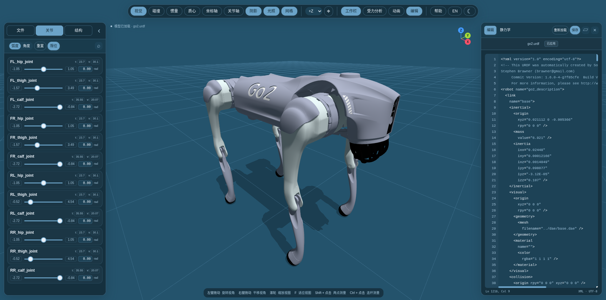
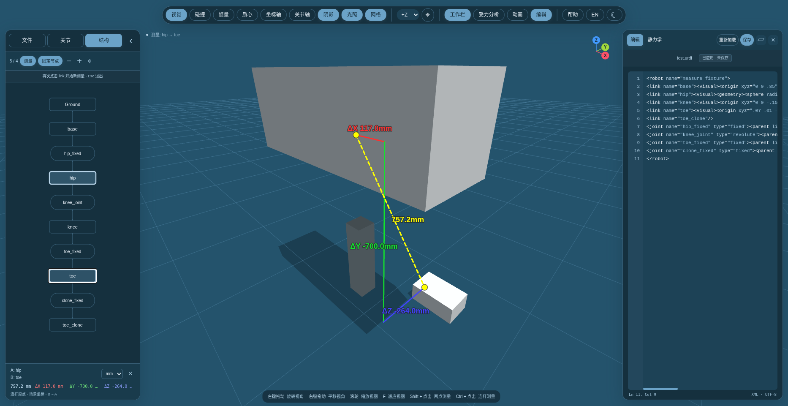
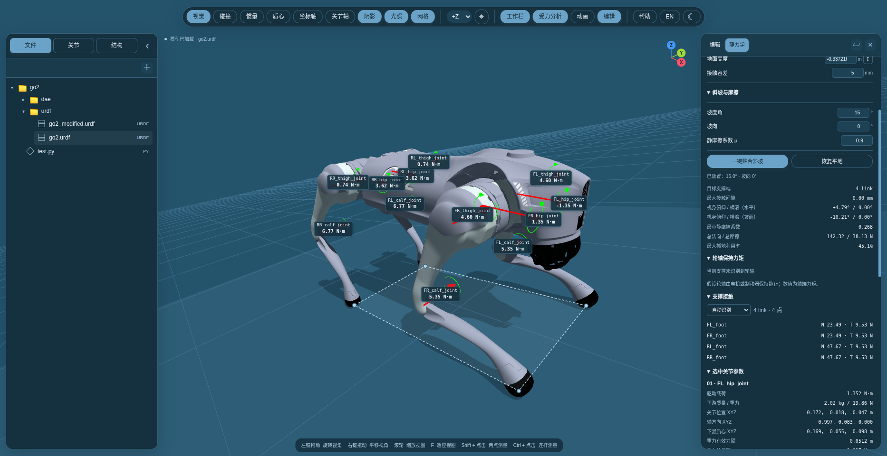

# URDF Viewer

[中文](README.md) | **English**

A browser-based URDF workbench for robot visualization, joint control, 3D measurement, code editing, and static load analysis. No frontend dependency installation required.



## Quick start

Run from the project directory:

```bash
python3 -m http.server 8080 --bind 127.0.0.1
```

Open [localhost:8080](http://localhost:8080). Choose a bundled example or load a complete robot folder containing its URDF, meshes, and textures. Serve the page over HTTP.

Chrome / Edge is recommended. Saving back to a source file requires localhost or HTTPS and file write permission. For bundled examples, select the matching original file on disk when saving for the first time.

## Features

- **Models and structure**: file / folder import, drag and drop, and a structure graph. Bundled examples include Go2, G1, ANYmal B / C, and Cassie.
- **Joint control**: pose robots by dragging links or sliders; joint limits and degrees / radians. Double-click a link to locate its joint and code.
- **Visual helpers**: visual and collision geometry, centers of mass, equivalent inertia boxes, link frames, and joint axes. Light / dark themes and Chinese / English UI.
- **3D measurement**: point-to-point or link-origin distance with XYZ components, with up to 5 geometric snap candidates.
- **Edit and save**: XML highlighting, validation, model reload, and saving edits directly to the source file.
- **Keyframe motion**: set a default stand, fix the foot-contact ground, author ground-relative base and joint poses, choose interpolation or constrained kinematic optimization with foot locks and rate-based retiming, retain full flip turns, and export JSON / CSV references. [Workflow and data format](docs/motion.md#english).
- **Statics**: live joint torques, contact reactions, and moment arms. Configure slope and friction, fit wheels / feet to the ground, and solve body attitude.

| 3D distance and XYZ components | Slope contacts and joint torques |
| --- | --- |
|  |  |

## Controls

| Action | Result |
| --- | --- |
| Left-drag background / right-drag / scroll | Orbit / pan / zoom |
| Drag a link / click its axis readout | Adjust joint / enter target angle or displacement |
| Double-click a link | Locate its joint card and link code |
| Shift + click two points | Measure surface points with snapping; hold Alt to bypass snapping |
| Ctrl + click two links or graph nodes | Measure link-origin distance; release Ctrl to resume joint dragging |
| Ctrl + Enter / Ctrl + S | Apply code to the model / save the source file |
| F / Esc | Fit model to view / clear measurements and selection |

## Static analysis

Set a standing pose and enable load analysis. For slopes, configure the angle, heading, and static friction coefficient, then fit the robot to the slope. Placement solves the body attitude from contact geometry while preserving joint values. Click a torque label to inspect forces and moment arms; click again to restore all labels.

Results estimate static loads under gravity and ground contact, using a minimum-squared-load distribution for multiple contacts. Dynamic inertia, drivetrain efficiency, and rolling resistance are excluded. Wheel torques represent the axle torque needed to hold position. Incompatible contacts, unstable support, or insufficient friction produce a warning instead of valid standing torques.

## Validation

With Python 3 and Chrome / Chromium installed, run the browser regression checks:

```bash
python3 tests/browser_smoke.py
```

Set `CHROME_BIN` to use a specific browser executable.

## References and contributions

- [**urdf-loader**](https://github.com/gkjohnson/urdf-loaders) — Robust URDF loading for Three.js; the URDF loading and joint interaction foundation reused by this project.
- [**robot_viewer**](https://github.com/fan-ziqi/robot_viewer) — A reference for the robot visualization workbench and interaction design.

Thanks to the authors of these projects and the open-source community. Report bugs through [Issues](https://github.com/XinLang2019/urdf_visualizer/issues), or submit a Pull Request to improve features, documentation, and examples. Include reproduction steps and validation results for functional changes, and retain upstream and model-resource attribution and license notices.
