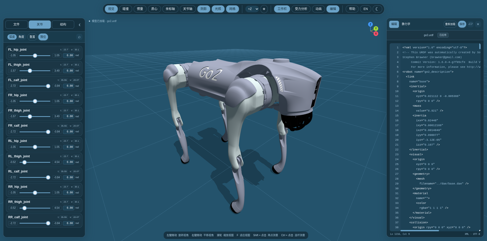
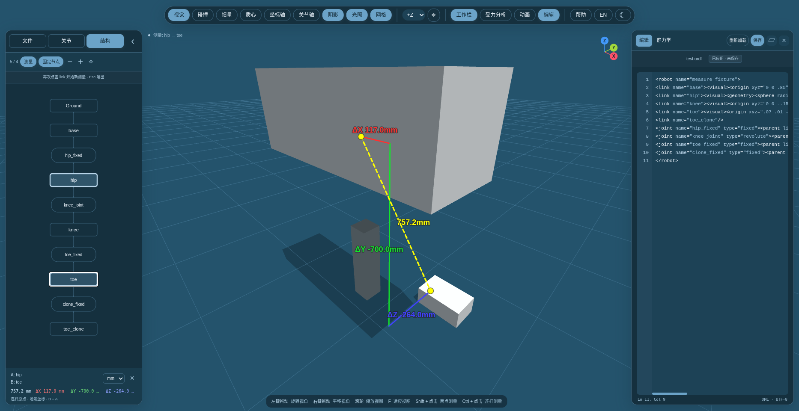
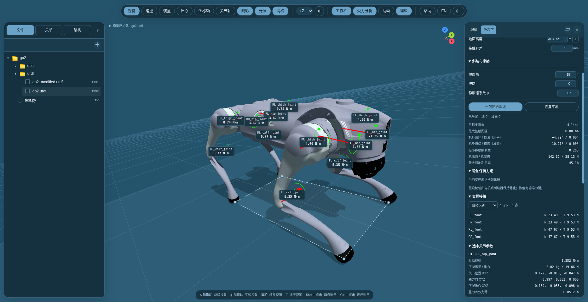
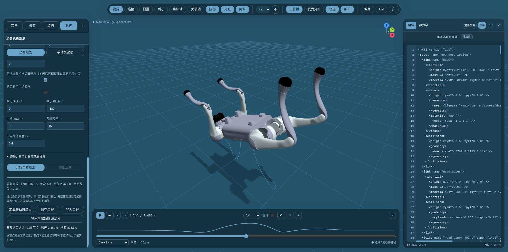

# URDF Viewer

**中文** | [English](README.en.md)

浏览器中的机器人 URDF 工作台，集模型预览、关节调节、三维测量、代码编辑与静力学分析于一体，无需安装前端依赖。



## 快速开始

在项目目录运行：

```bash
python3 planner_server.py --port 8080
```

全身规划需配置相邻的 `go2_flip_TO` 项目和包含 Pinocchio / cyipopt 的 Python 环境；可用 `--solver-root`、`--solver-python` 指定路径。[配置与使用](docs/planning.md)。仅浏览模型可继续使用 `python3 -m http.server 8080`。

访问 [localhost:8080](http://localhost:8080)，选择内置示例，或加载包含 URDF、网格与纹理的完整机器人文件夹。请通过 HTTP 打开页面。

推荐 Chrome / Edge。保存源文件需要在 localhost 或 HTTPS 下授权文件写入；内置示例首次保存时需选择磁盘上对应的原文件。

## 主要功能

- **模型与结构**：文件 / 文件夹导入、拖拽加载、结构拓扑；内置 Go2、G1、ANYmal B / C、Cassie 示例。
- **关节控制**：拖动连杆或滑块调姿，支持限位和角度 / 弧度切换；双击连杆定位关节和代码。
- **辅助显示**：视觉、碰撞、质心、等效惯量长方体、坐标轴与关节轴；支持明暗主题和中英文界面。
- **三维测量**：两点或两连杆原点之间的距离及 XYZ 分量，提供最多 5 个几何吸附候选点。
- **编辑与保存**：XML 高亮、校验、重新加载，修改后直接保存到源文件。
- **全身轨迹规划**：Go2 全身动力学优化，编辑接触时序、摩擦、电机限值、落地与腾空姿态约束；实时进度、自动播放和力矩 / 接触力导出。[使用说明](docs/planning.md)。旧的[手动关键帧](docs/motion.md)仍可使用。
- **静力学分析**：实时关节力矩、支撑反力和力臂；设置坡度与摩擦系数，一键贴合轮子 / 足端并计算机身姿态。

| 三维距离与 XYZ 分量 | 斜坡接触与关节力矩 |
| --- | --- |
|  |  |



## 常用操作

| 操作 | 功能 |
| --- | --- |
| 左键拖动空白 / 右键拖动 / 滚轮 | 旋转 / 平移 / 缩放视图 |
| 拖动连杆 / 点击轴旁数值 | 调节关节 / 输入目标角度或位移 |
| 双击连杆 | 定位关节卡片与对应 link 代码 |
| Shift + 点击两点 | 表面点测量与几何吸附；Alt 暂停吸附 |
| Ctrl + 点击两个连杆或结构节点 | 测量连杆原点间距离；松开恢复关节拖动 |
| Ctrl + Enter / Ctrl + S | 应用代码到模型 / 保存源文件 |
| F / Esc | 适应模型视图 / 清除测量与选择 |

## 静力学分析

调好站姿后开启“受力分析”。斜坡分析需设置坡度、坡向和静摩擦系数，再点击“一键贴合斜坡”；保持关节值不变，根据接触几何求解整机姿态。点击力矩标签可查看力与力臂，再次点击恢复全部标签。

结果是重力与地面接触作用下的静态估算，多接触载荷采用最小平方分配；不包含动态惯性、传动效率或滚阻。轮轴结果表示保持静止所需的轴端力矩。无法同时接地、支撑不稳或摩擦不足时会提示，不输出有效站立力矩。

## 验证

安装 Python 3 和 Chrome / Chromium 后运行浏览器回归检查：

```bash
python3 tests/browser_smoke.py
```

可通过 `CHROME_BIN` 指定浏览器路径。

## 参考与贡献

- [**urdf-loader**](https://github.com/gkjohnson/urdf-loaders) — Robust URDF loading for Three.js；本项目复用的 URDF 加载与关节交互基础。
- [**robot_viewer**](https://github.com/fan-ziqi/robot_viewer) — 机器人可视化工作台与交互设计参考。

感谢以上项目的作者及开源社区贡献者。欢迎通过 [Issues](https://github.com/XinLang2019/urdf_visualizer/issues) 反馈问题，或提交 Pull Request 改进功能、文档和示例；修改功能时请附复现步骤与验证结果，并保留上游项目及模型资源的署名和许可说明。
