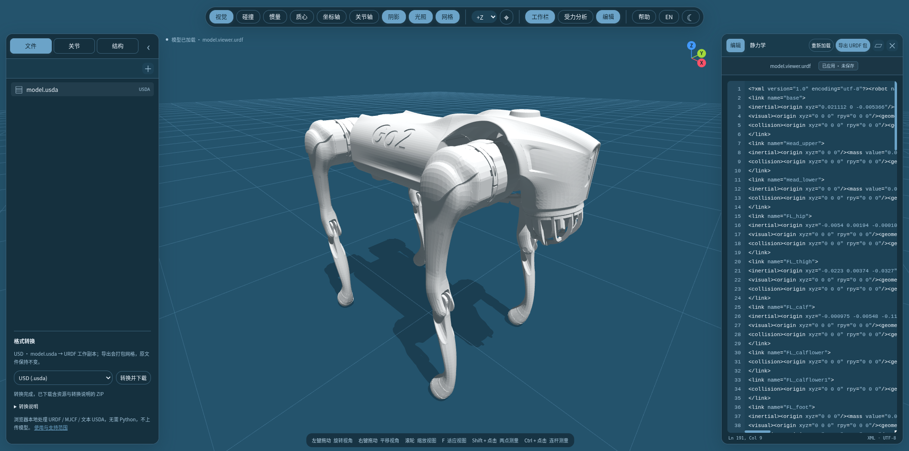

# 模型格式 / Model formats

**中文** · [English](#english)

GitHub Pages 与普通静态服务可直接加载 **URDF、MJCF、文本 USDA**，并支持三种格式六个方向的转换。模型解析、转换和 ZIP 打包均在浏览器本地完成，**无需 Python，不上传模型**。

## 使用

1. 选择内置模型，或加载完整模型文件夹，包括 MJCF include、网格等资源。
2. MJCF / USDA 的原格式代码显示在编辑器中；内部转换为 URDF 用于关节控制、测量和静力学。修改后点击“重新加载”应用，或“保存”覆盖已授权的原文件。
3. 文件栏选择 URDF、MJCF 或 USD，再点击“转换并下载”。在线版的 USD 输出为标准文本 **`model.usda`**。
4. 解压 ZIP 后，保持模型文件与 `meshes/` 相邻；`conversion-report.json` 记录单位、转换差异与限制。

转换使用当前编辑器的模型代码；滑块中的当前关节角度不作为模型零位写入。URDF、MJCF 和文本 USDA 的“保存”均写入对应源文件；首次保存需选择并授权原文件。原生服务加载的二进制 USD 保留 URDF 工作副本与“导出 URDF 包”，不将 XML 写入二进制源文件。

需要 CAD 装配时，选择 **STEP (.step)**；保留连杆层级、几何缩放及 URDF 零位装配位置，输出为毫米单位的静态三角面几何。[STEP 使用说明](step-export.md)。

在线直接打开 GitHub Pages。开发时可以运行任意静态服务，例如 `python3 -m http.server 8080`，然后打开 [localhost:8080](http://localhost:8080)。这里的 Python 只是开发用静态服务器，模型处理完全在浏览器进行。直接用 `file://` 打开可导入本地文件，但内置示例仍需要 HTTP。



## 浏览器支持范围

| 数据 | 支持与限制 |
| --- | --- |
| 模型 | URDF；MJCF `.xml` / `.mjcf`；以 `#usda` 开头的文本 `.usda` / `.usd`。二进制 `.usdc` / `.usd` 与 USDZ 不在浏览器版范围内。 |
| 关节 | 单父树形结构；固定、转动、连续转动、移动和浮动根。MJCF 每个 body 暂支持一个关节；球铰、多关节 body、闭环、USD D6 需先转换或展开。 |
| MJCF | include、default / class / childclass；局部坐标；角度单位与旋转序列；关节位置、ref、限位；显式质量与完整惯量。基础几何可按 mass / density 计算惯量，网格无显式惯量时保留未知值。 |
| USDA | 单个已展开场景；常用 xformOp 及顺序；Y / Z 向上与单位；UsdPhysics 刚体、两侧关节帧、质量、质心、主惯量轴。关节两侧须处于一致的零位。引用层、payload、变体、over / class、动画需先 flatten / bake。 |
| 几何 | 盒、球、圆柱；MJCF 胶囊、椭球；USD 基础几何；三角面 / 四边面网格。浏览器网格转换支持 STL、OBJ、DAE；曲面按三角网格导出，复杂面与带孔面需先三角化。 |
| 惯量 | URDF 惯量坐标和 USD 主惯量轴会转换。未知参数不补造；MJCF 导出要求运动刚体具有正质量和物理有效的惯量。 |
| 材质 | 常量 RGBA；不迁移贴图、复杂着色器或网格面材质。DAE 按现有查看器的坐标约定解析。 |
| 扩展 | 不重建控制器、传感器、肌腱、仿真器调参或求解器约束。URDF mimic 写为 MJCF equality 或 USD 元数据。 |

转换文件并不保证仿真器之间动力学等价。浏览器版不调用 MuJoCo 编译器或 OpenUSD SDK；差异说明会随模型包导出。无法表示的输入明确报错，并保留先前已加载模型。单次输入上限 384 MiB / 1500 文件；大网格转换会占用浏览器内存与计算时间。

## 可选原生模式：二进制 USD

如果需要二进制 USD / USDZ、USD 引用层或更完整的 MJCF 编译解析，可继续使用本地原生服务。这不是在线版的前置要求。

```bash
python3 -m venv .venv-formats
.venv-formats/bin/python -m pip install -r requirements-formats.txt
python3 model_server.py --port 8080
```

需要 Python 3.10+。打开 [localhost:8080/?formats=native](http://localhost:8080/?formats=native) **显式启用原生模式**；不带参数时仍使用浏览器模式。服务自动选择 `.venv-formats/bin/python`，也可用 `--python /path/to/python` 指定。此模式会把模型传给本机服务处理，USD 输出为二进制 `.usd`。

## 验证

```bash
# Edge + 普通静态服务器：六方向互转、网格、原格式编辑、多模型、关节与零 API 请求
URDF_TEST_BROWSER_FORMATS=1 CHROME_BIN=/usr/bin/microsoft-edge .venv-formats/bin/python tests/model_formats_browser.py
# 原生模式
CHROME_BIN=/usr/bin/microsoft-edge .venv-formats/bin/python tests/model_formats_browser.py
.venv-formats/bin/python -m unittest discover -s tests -p test_model_formats.py
# 原有工作台回归
CHROME_BIN=/usr/bin/microsoft-edge python3 tests/browser_smoke.py
```

测试工具使用原生 SDK 独立核对浏览器生成文件的质心、惯量和不同关节角度下的几何位置；SDK 仅为开发验证依赖，网页用户无需安装。

参考：[MuJoCo XML](https://mujoco.readthedocs.io/en/stable/XMLreference.html)、[OpenUSD Physics](https://openusd.org/release/api/usd_physics_page_front.html)、[USD 变换](https://openusd.org/release/user_guides/schemas/usdGeom/Xformable.html)。

---

## English

**URDF / MJCF / text USDA loading and all six conversion directions work directly on GitHub Pages and ordinary static hosting.** Parsing, mesh conversion and ZIP generation run locally in your browser. No Python installation or model uploads.

Load an example or a complete model folder. MJCF / USDA imports show their original source in the editor, with an internal URDF representation for joint, measurement and statics tools. Reload applies native code edits; Save writes the authorized original source. Choose a target under **Convert format** and download a ZIP; online USD export is standard text **`model.usda`**. Keep the model and `meshes/` together and read `conversion-report.json`. Conversion uses editor source, not slider values as new model zero positions. Binary USD in native mode retains the explicit URDF working copy and **Export URDF ZIP** action; it never writes XML into the binary source.

Choose **STEP (.step)** for a static CAD assembly retaining the link tree, mesh scales and URDF zero-pose placements in millimetres. Mesh-derived geometry remains faceted. [STEP workflow and limits](step-export.md#english).

For development, any static server works, including `python3 -m http.server 8080`; Python then serves files only. File imports also work via `file://`, but bundled examples require HTTP.

Browser readers support rigid-body trees, fixed / revolute / continuous / prismatic joints and floating roots; joint frames, limits, explicit mass, COM and inertia; MJCF includes / defaults, angle units and primitive mass / density; flattened USDA with common xform operations, units, Y/Z up, UsdPhysics joint frames and principal inertia axes. Mesh conversion supports STL, OBJ and DAE. USDA meshes need triangles or quads. Materials reduce to constant RGBA.

Browser limitations: binary USD / USDZ; USD composition, variants, over / class specs, animation and nonzero joint reference-frame mismatch; MJCF multi-joint bodies, ball joints, procedural models and plugins; closed loops / D6 constraints. Flatten, bake, triangulate or expand these in the source tool first. Missing mesh-body masses / inertias are not invented. MJCF export requires physical positive inertia on moving bodies. Controllers, sensors, tendons, textures and simulator extensions are not reconstructed. Interchange does **not** guarantee equivalent simulation dynamics. Unsupported inputs fail explicitly and retain the last model. Inputs are limited to 384 MiB / 1500 files; large meshes use browser memory and CPU.

**Optional native mode:** for binary USD / USDZ, referenced USD layers and more complete native MJCF parsing, install `requirements-formats.txt` in `.venv-formats` and start `python3 model_server.py`. Python 3.10+ is required. Explicitly open [localhost:8080/?formats=native](http://localhost:8080/?formats=native). This mode sends files to your local service, uses MuJoCo / OpenUSD and exports binary USD. Without the query parameter, the browser mode remains the default.

The validation commands above test both engines. Native SDKs independently check browser-exported physical frames and inertial data during development; they are not runtime requirements for online users.
