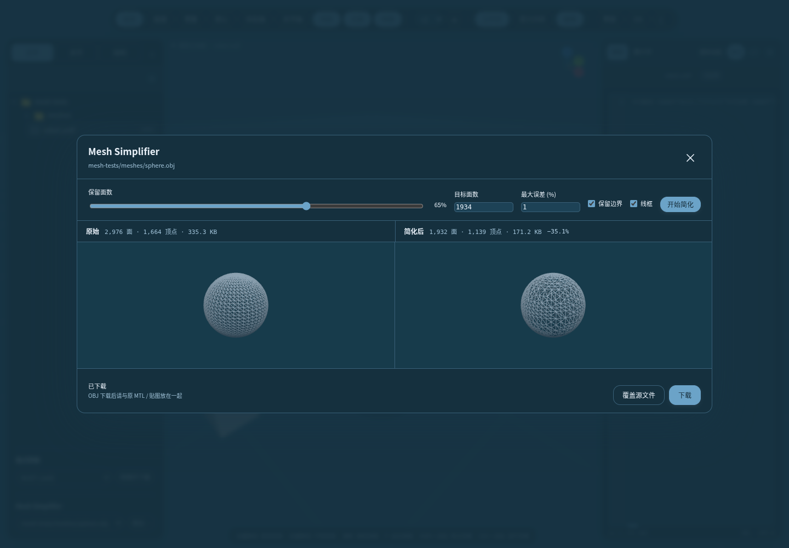

# Mesh Simplifier

**中文** · [English](#english)

直接在浏览器中简化 STL / OBJ / DAE，无需 Python，也不上传模型。

1. 加载机器人文件夹，或单独加载包含 STL / OBJ / DAE 的网格文件夹。
2. 在文件栏 **Mesh Simplifier** 中选择网格，点击“简化…”；也可以直接点击文件树中的 STL / OBJ / DAE。
3. 设置保留比例或目标面数、最大误差，点击“开始简化”。左右视图同步旋转和缩放，可切换线框，比较面数与文件大小。
4. 点击“下载”获得同格式的 `.simplified.stl` / `.simplified.obj` / `.simplified.dae`，或点击“覆盖源文件”写回原文件。

“最大误差”是相对于网格尺寸的近似误差上限；保留边界、材质分组、UV 接缝等保护可能使实际面数高于目标，界面显示实际结果。更低的目标面数或更大的误差通常会减少更多细节。STL 导出为二进制格式，OBJ 保留对象 / 分组、材质名称与 MTL 引用、UV、法线及 RGB 顶点色。OBJ 与原有 MTL / 贴图需保持原来的相对路径。DAE 只替换几何网格，保留节点层级、实例、变换、单位、坐标轴、材质与贴图引用，导出仍为 DAE；下载后需保持贴图的相对路径。

简化保留原始坐标和单位，不修改 URDF 中的缩放、关节、质量或惯量。写回当前机器人的网格后会重新加载其所有实例，并保留关节角度。简化不是重新计算质量和惯量；需要物理参数变化时请另行更新模型定义。

覆盖需要 Chrome / Edge、localhost 或 HTTPS，以及文件写入权限。通过“加载文件夹”获得句柄时会复用原文件；拖入文件或文件输入框无法提供句柄时，会让你选择同名原文件并核对内容。文件在预览后被其他程序修改时会拒绝覆盖，请重新加载后再简化。下载与预览不会修改源文件。关闭窗口可中止正在进行的后台计算。

支持静态 DAE 三角网格、多边形、三角带与三角扇；带蒙皮、变形器或动画的 DAE 请先烘焙为静态网格。OBJ 多边形会三角化；曲线、点云、齐次权重及三维纹理坐标需先在建模工具中转换。单个输入上限 384 MiB / 800 万面，大模型会使用较多浏览器内存。

算法使用 [meshoptimizer 1.0](https://github.com/zeux/meshoptimizer/tree/v1.0)；源码、WebAssembly 和 MIT 许可随项目托管，不依赖外部 CDN。

验证：`CHROME_BIN=/usr/bin/microsoft-edge python3 tests/mesh_simplifier.py` 与 `CHROME_BIN=/usr/bin/microsoft-edge python3 tests/mesh_dae.py`。

## English

Simplify STL / OBJ / DAE meshes locally in your browser, with no Python or model uploads.

Load a robot or a standalone mesh folder. Select a mesh under **Mesh Simplifier**, or click an STL / OBJ / DAE file in the tree. Set the keep ratio or target face count and maximum relative error. Run simplification, compare the synchronized previews and wireframe, then download a `.simplified.stl` / `.simplified.obj` / `.simplified.dae` or **Overwrite source**.

Topology, boundary locks, material groups and UV seams can prevent reaching the requested face count; actual results are displayed. STL exports as binary STL. OBJ retains object / group names, material / MTL references, UVs, normals and RGB vertex colors. Keep the original MTL / textures at their relative paths. DAE output replaces only mesh geometry, preserving node hierarchy, instances, transforms, units, up axis, material bindings and texture references. Keep textures at their original relative paths.

Source coordinates and units are retained; URDF scale, joint, mass and inertia definitions are unchanged. Saving a robot mesh refreshes all its visual / collision instances while preserving joint angles. Simplification does not recalculate physical parameters.

Overwrite requires Chrome / Edge, localhost or HTTPS, and file write access. Native folder handles are reused. File-input / drag imports without handles prompt for the matching original, verified by content. External changes since preview block overwriting. Preview and download never modify originals. Close the dialog to terminate computation.

Static DAE triangle meshes, polygons, triangle strips and fans are supported; bake skinned, morphed or animated DAE files to a static mesh first. Triangulatable OBJ polygons are also supported. Convert curves, points, weighted homogeneous coordinates and 3D UVs first. Inputs are limited to 384 MiB / 8 million faces. Algorithms run in a browser worker using the locally vendored, MIT-licensed meshoptimizer 1.0.
