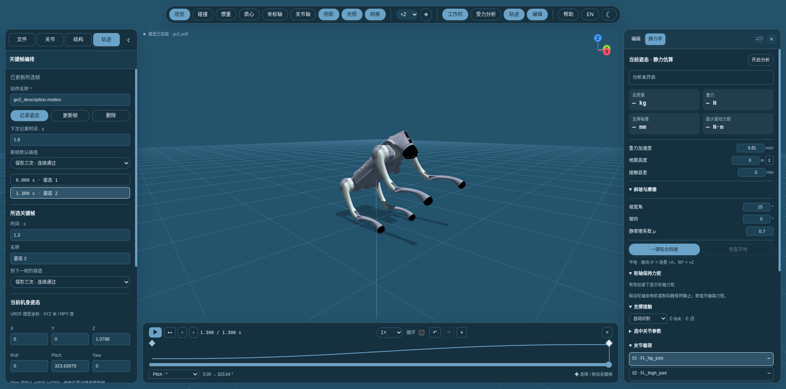

# 关键帧动作编排 / Keyframe motion authoring

[中文说明](#中文) · [English guide](#english)

## 中文

点击顶部“轨迹”或左侧“轨迹”标签。编辑器记录**独立关节 + 机身六自由度姿态**，不修改 URDF 文件。

1. 点击“默认站姿并接地”：`hip=0、thigh=0.8、calf=−1.5 rad`（遵守 URDF 限位）。人形或其他命名模型可手动调姿，再点“按当前站姿固定地面”。然后记录首帧 `0 s`。
2. 在关节标签中拖动连杆、滑块或输入关节值；在轨迹标签中设置机身 XYZ、Roll / Pitch / Yaw，也可单击三维机身，在旁边的浮动编辑框中直接修改，并记录或更新关键帧。
3. 设置“下次记录时间”，再次记录。选择已有帧后，“更新帧”将当前三维姿态写回该帧；单纯拖动模型不会自动覆盖关键帧。
4. 点击时间轴菱形选择关键帧；拖动菱形或修改帧时间调整节奏。首帧固定在 0 秒。时间滑块用于预览，支持逐采样帧、变速、循环、撤销和重做。时间轴的 ⌖ 按钮适应整段轨迹；轨迹栏内 Ctrl + S 保存动作工程。
5. 用“保存工程”导出可再次编辑的 `.motion.json`；用“导出参考”按指定 Hz 输出 JSON，或 CSV + 元数据 JSON。

参考地面按初始站姿的足端 / 轮底接触建立，固定为 **Z=0、Z 轴向上**；机身 Z 显示根连杆原点的离地高度。命名足端不共面（间隙超过 5 mm）或机身穿地时会提示调整，不会强行移动足端。后续调姿、播放和适应视图不会移动地面。已有关键帧时，默认站姿只改变当前预览，保留关键帧和参考地面；重新标定地面需“新建动作”，可撤销。进入模式不会自动重新取景，可用时间轴的 ⌖ 查看整段动作。

### 插值与空翻

| 方式 | 行为 |
| --- | --- |
| 线性 | 每段匀速；关键帧处速度可能跳变 |
| 三次缓入缓出 | 每个关键帧速度为零，适合停顿动作 |
| 五次缓入缓出 | 每个关键帧速度和加速度为零，适合停稳过渡 |
| 保形三次 | 非均匀时间 PCHIP，连续通过关键帧，避免关节过冲；加速度不保证连续 |

每帧的插值设置作用于**该帧到下一帧**。连续通过模式应应用于相邻各段；混用插值可能造成端点导数不连续。

默认姿态为连续 RPY，支持 `0° → 180° → 360°`，或 `0° → −360°`，保留空翻方向和圈数。连续关节也保留累积角度。SLERP 使用四元数最短路径，`0° → 360°` 不会产生整圈旋转；选择 SLERP 时，保形三次的姿态通道使用三次缓入缓出的 SLERP，关节和位置仍使用 PCHIP。

+Z 向上的模型可生成前 / 后空翻**运动学示意**，然后分别调整起跳、腾空收腿、落地等关键帧。模板只编排机身位姿，保留当前关节姿态，不是动力学求解出的可执行空翻。

### 运动学约束优化

记录至少两帧后，在各帧的“到下一帧的接触阶段”中选择 **支撑** 或 **腾空**，再点击“优化轨迹”。支撑段可勾选实际着地的足端；连续支撑段沿用同一接触位置，离地后再次支撑会建立新的落点。未设阶段时为自由运动，不锁足端。

- **更连贯**：联合最小化整段位置 / 连续 RPY / 关节坐标的加加速度平方积分，使用 C² 连续五次多项式，首尾速度和加速度为零，中间帧可连续通过。
- **有限制**：Bezier 控制点约束保证整段关节位置不越限；按用户速度 / 加速度及 URDF 速度上限统一延长时长。机身线速度与空间角速度 / 加速度采用保守向量上界。关闭自动延时后，超限会报错。
- **接触一致**：通过隔离 URDF 副本上的阻尼逆运动学调整支撑腿，随后重新平滑。每段多项式分成 6 个子区间检查接触和模型几何穿地，误差超过 2 mm 会拒绝结果。此检查是离散采样，不保证采样间绝无穿地；碰撞几何缺失时使用视觉几何估计。未设置参考地面的旧工程不检查地面。
- **可恢复**：原始关节目标保留；优化曲线用于预览、播放和导出，支撑段的关节结果可能偏离原始目标。修改关键帧或优化参数后需重新优化；支持取消、撤销、重做和保存 / 导入。“使用原插值”保留当前时刻设置，撤销可恢复优化前时长。

当前支持 2–60 个关键帧、帧间至少 0.01 s、连续 RPY 模式。足端锁定只约束几何接触位置；未约束矩形足底朝向、轮子无滑滚动、摩擦或动态支撑稳定性。**腾空阶段不锁足端，但也不强制重心抛物线或角动量守恒**，因此空翻仍是运动学参考。

完整动力学优化需要浮动基座动力学、接触力 / 摩擦锥、力矩限值及接触切换，不能用当前静力学分析替代。导出中的 `metadata.optimization` 报告误差、时长缩放、约束上界，并明确 `dynamicsValidated: false`。工程内 `optimization` 保存求解后的五次多项式节点，`optimizerSettings` 保存限制；两者随工程一起保存。

### 导出约定

- `schema: urdf-viewer.motion.v1`：可编辑工程，包含模型签名、关键帧、插值和采样设置。导入需匹配当前模型名称、根连杆、独立关节名称、类型及顺序，并按当前 URDF 限位校验。
- `schema: urdf-viewer.reference.v1`：采样参考。`frames` 每行包含 `time`、`base_position`、`base_rpy`、`base_quaternion`、`joint_positions`，以及机身线 / 角速度、线 / 角加速度、关节速度与加速度。
- 时间为秒，平移为米，旋转为弧度；四元数顺序为 **xyzw**，相邻采样的四元数保持符号连续。
- 新工程的机身位姿、线 / 角速度和加速度均在**固定地面坐标系**表达。RPY 对应 `Rz(yaw) Ry(pitch) Rx(roll)`。角速度为空间角速度，**不是 RPY 的直接差分**。
- `metadata.independent_joints` 明确数组关节顺序；移动关节单位为米，其余为弧度。mimic 关节不独立导出，可由 URDF 约束还原。内部 floating / planar 关节暂不支持记录。
- 工程的 `reference`（采样数据的 `metadata.reference_transform`）保存初始站姿、接触点及地面到 URDF 根父坐标系的变换：`p_urdf = origin + R(quaternion) · p_ground`，`q_urdf = quaternion ⊗ q_ground`。新工程的 `metadata.ground_plane` 为 `{normal:[0,0,1], offset:0}`；`urdf_ground_plane` 保留原模型坐标中的平面。缺少 `reference` 的旧工程继续使用原 URDF 父坐标，不会被自动平移。
- 采样包含最后一个关键帧时刻；总时长不整除采样间隔时，最后一段间隔更短。导数由插值函数解析计算，在线性拐点等不可微位置采用所在段的单侧值。
- `diagnostics` 给出采样得到的关节峰值速度及 URDF 速度超限关节。常规插值报告速度超限；约束优化启用自动延时后会调整动作时长。
- 循环只是回到起点播放，**不自动修复首尾位置 / 速度接缝**。有限角度关节的相同姿态、连续旋转的圈数和机身四元数需分别判断。

输出是用于轨迹跟踪、模仿学习的**运动学参考**，接触阶段由用户指定，未求解逆动力学、自碰撞、执行器力矩或落地可行性。播放和预览会暂停原静力学标签，避免把腾空动作解释为静止支撑。

## English

Open **Motion** from the toolbar or left workspace. Each keyframe stores independent joint positions and the base's six-degree-of-freedom pose without changing the URDF.

1. Choose **Default stand & ground** (`hip=0, thigh=0.8, calf=−1.5 rad`, clamped to URDF limits), or pose a humanoid / other model manually and choose **Set ground from stance**. Record the first key at `0 s`.
2. Adjust links or joint sliders in Joints; edit base XYZ and Roll / Pitch / Yaw in Motion, or click the 3D chassis to edit them beside the model and record or update a key.
3. Set the next recording time and record again. Select a key and use **Update key** to replace its pose; posing the robot alone does not overwrite a key.
4. Select or drag timeline diamonds, or edit key times. The first key remains at zero. Scrub, step by one sample, adjust playback speed, loop, undo, or redo. Use ⌖ to fit the whole trajectory; Ctrl + S inside Motion saves the project.
5. Save `.motion.json` for further editing. Export sampled references as JSON or CSV with a metadata JSON sidecar at your chosen Hz.

The initial foot / wheel contacts define a fixed **Z-up ground frame with the surface at Z=0**. Base Z is the root origin’s height above that surface. Named supports more than 5 mm apart in height, or body penetration, require adjusting the stance first. Posing, playback, and fitting the view keep this floor fixed. With existing keys, the standing preset changes only the current preview; keys and their reference remain intact. Use **New motion** to recalibrate; setup is undoable. Entering Motion does not refit the camera; use ⌖ to fit the whole trajectory.

### Interpolation and flips

| Mode | Behavior |
| --- | --- |
| Linear | Constant segment speed; velocity may jump at keys |
| Cubic easing | Zero velocity at every key |
| Quintic easing | Zero velocity and acceleration at every key |
| Shape-preserving cubic | Nonuniform PCHIP, continuous passage and no joint overshoot; acceleration may jump |

A key's mode controls its **outgoing segment**. Use consistent modes across neighboring segments for derivative continuity.

Unwrapped RPY retains turns, e.g. `0° → 180° → 360°` or `0° → −360°`. Continuous joints retain winding too. Quaternion SLERP uses the shortest path, so `0° → 360°` does not create a flip. In SLERP mode, cubic orientation uses eased SLERP with zero endpoint angular velocity, while positions and joints retain PCHIP.

For +Z-up models, the front/back flip sketches animate base pose and preserve the current joints. Author takeoff, tuck, and landing joint poses afterward. These sketches are kinematic examples, not dynamically solved flips.

### Constrained kinematic optimization

Record at least two keys, set each outgoing contact phase to **Support** or **Flight**, and click **Optimize trajectory**. Select the feet actually in support. Consecutive support segments reuse contact anchors; a new support after release creates a new landing anchor. Unspecified phases are free motion without foot locks.

- **Continuity**: globally minimize integrated squared jerk of position, unwrapped RPY, and joint coordinates with C² quintic splines. Endpoint velocity / acceleration are zero; intermediate keys can flow through.
- **Limits**: Bezier control-point constraints bound joint positions for the whole polynomial. Uniform retiming respects user speed / acceleration limits and URDF joint speeds, using conservative vector bounds for base linear and spatial angular rates. Disabling retiming makes rate violations fail.
- **Contacts**: damped IK on an isolated URDF clone adjusts support joints, followed by spline smoothing. Six subintervals per polynomial check foot residuals and ground penetration; errors above 2 mm reject the result. These are sampled checks, not a continuous collision certificate. Visual geometry is an estimate when collision geometry is absent. Legacy projects without a reference floor skip ground checks.
- **Editing**: authored joint targets remain intact; preview / playback / export use the solved curve, which can adjust support joints away from those targets. Key or limit edits require re-optimization. Cancel, undo / redo, and project save / import are supported. **Use interpolation** keeps current key times; Undo restores the previous timing.

Supports 2–60 keys, intervals of at least 0.01 s, and unwrapped RPY. Foot locks constrain geometric contact positions; sole orientation, no-slip wheel rolling, friction, and dynamic support stability are not constrained. **Flight releases feet but does not enforce ballistic center-of-mass motion or angular-momentum conservation.** Flips remain kinematic references.

Full dynamics requires floating-base equations, contact forces / friction cones, actuator torque limits, and contact switching; the statics tool cannot substitute for this solve. Exported `metadata.optimization` includes residuals, timing scale, conservative bounds, and `dynamicsValidated: false`. Projects save solved quintic knots in `optimization` and limits in `optimizerSettings`.

### Reference data

- Editable projects use `urdf-viewer.motion.v1`. Imports must match the current model, root, independent joint names, types, and order; joint limits come from the current URDF.
- Sampled references use `urdf-viewer.reference.v1`. Each frame includes time, base position / RPY / quaternion, joint positions, base linear / angular velocity and acceleration, and joint velocity / acceleration.
- Units are seconds, meters, and radians. Quaternion order is **xyzw**, with continuous signs between samples.
- New projects express base pose, linear / angular velocity, and acceleration in the **fixed ground frame**. RPY means `Rz(yaw) Ry(pitch) Rx(roll)`. Angular velocity is spatial rather than differentiated Euler angles.
- `metadata.independent_joints` defines array order; prismatic positions are meters. Mimic joints are excluded and reconstructed from URDF constraints. Internal floating / planar joints are not supported for recording.
- Project `reference` (sampled `metadata.reference_transform`) stores the initial stance, contacts, and ground-to-URDF-parent transform: `p_urdf = origin + R(quaternion) · p_ground`, `q_urdf = quaternion ⊗ q_ground`. New `metadata.ground_plane` is `{normal:[0,0,1], offset:0}`; `urdf_ground_plane` preserves the plane in native model coordinates. Legacy projects without `reference` retain their original URDF-parent coordinates without automatic shifting.
- Sampling includes the exact final key; the final interval may be shorter than `1 / fps`. Derivatives are analytical and piecewise, with one-sided values at nonsmooth knots.
- `diagnostics` reports sampled peak joint speeds and URDF velocity-limit violations. Ordinary interpolation reports speed violations; constrained optimization can automatically extend timing.
- Loop playback restarts at zero; it does **not** repair pose or velocity discontinuities at the seam.

Exports are **kinematic reference motions** for tracking and imitation learning. Contact phases are user-authored. Inverse dynamics, self-collisions, actuator torques, and landing feasibility are not solved. Motion preview pauses quasi-static overlays.

## 方法参考 / Method references

- [Modern Robotics: polynomial time scaling](https://modernrobotics.northwestern.edu/nu-gm-book-resource/9-1-and-9-2-point-to-point-trajectories-part-2-of-2/)
- [SciPy: SLERP and shortest-path rotation](https://docs.scipy.org/doc/scipy/reference/generated/scipy.spatial.transform.Slerp.html)

- [MIT / Drake: trajectory optimization and dynamics constraints](https://underactuated.mit.edu/trajopt.html)
- [Drake: direct collocation](https://drake.mit.edu/doxygen_cxx/classdrake_1_1planning_1_1trajectory__optimization_1_1_direct_collocation.html)
