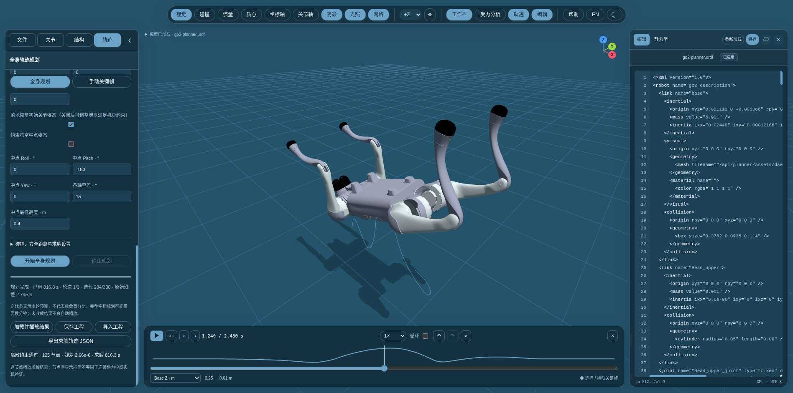

# 全身轨迹规划 / Whole-body trajectory planning

[中文](#中文) · [English](#english) · [手动关键帧 / Manual keyframes](motion.md)



## 中文

“轨迹”默认打开全身规划面板，接入 `go2_flip_TO/src/examples/agile_exps/quad_backflip.py` 所用的 **Pinocchio + IPOPT 全身轨迹优化**。旧的关键帧编辑器保留在“手动关键帧”中。

### 启动

在 URDF-Viewer 目录运行：

```bash
python3 planner_server.py --port 8080 \
  --solver-root ../go2_flip_TO \
  --solver-python ../se3_trajopt/.conda/bin/python
```

打开 [localhost:8080](http://localhost:8080)。Python 服务只使用标准库；`--solver-python` 指向安装了 `pinocchio`、`cyipopt`、`numpy`、`scipy`、`coal`（或 `hppfcl`）、`meshcat` 等规划项目依赖的环境。相邻目录符合上例时可以直接运行 `python3 planner_server.py`。服务默认只监听 `127.0.0.1`。

普通 `python3 -m http.server` 仍可用于查看模型和手动关键帧，但不能执行全身动力学规划。依赖或规划项目缺失时，面板会显示原因。

### 使用

1. 打开“轨迹”，点击“加载规划模型 · Go2”。规划模型包含转子惯量，电机限值也可能与普通 Go2 示例不同，不能直接混用。当前适配器支持 Go2。
2. 选择后空翻、前空翻、跳跃或站立验证模板。设置初始站稳、下蹲、蓄力、腾空、落地缓冲和结束站稳的时长。
3. 设置摩擦、关节速度、电机力矩比例；调整初始关节姿态和落地的机身位置 / 姿态。落地位移相对初始机身位置；默认要求恢复初始关节姿态，关闭该选项可让求解器调整落地关节以满足机身约束。可选的腾空中点姿态为硬约束，旋转误差向量各轴采用设置的容差，并可限制该点最低机身高度。
4. 在高级设置中调整网格碰撞、身体 / 腿 / 足端离地间隙、机身角速度、重力、深蹲 thigh 下界、迭代上限、续算轮数和时间限制。
5. 点击“开始全身规划”。界面显示真实 IPOPT 阶段、轮次、迭代、约束残差和耗时；进度条表示**当轮迭代预算**，不是收敛百分比。完整空翻可能需要数分钟到十几分钟。可随时停止，旧的可用轨迹会保留。
6. 收敛后会重新计算全部 NLP 约束及变量边界的残差，通过后直接加载并播放。底部时间轴支持暂停、拖动、逐节点步进、速度和循环。“导出求解轨迹 JSON”保留原始求解节点；“保存工程”还保留模型签名、固定地面和约束设置。“导入工程”也支持后端原始 `whole-body.v1` 结果 JSON。

时长按节点间隔量化，限制为 4–160 个节点。沿用原脚本的节点定义：K 个节点的最后时刻为 `(K−1) × dt`。求解器会检查后 / 前空翻的旋转方向和圈数；“收敛但没有完成一圈”也不会作为成功结果播放。改变约束不保证总能求得可行动作，失败时可根据残差调整姿态、时序或限值。

### 求解与播放约定

- 全身动力学、半隐式积分、接触位置 / 高度、线性化摩擦锥、URDF 关节位置 / 速度 / 力矩限制，以及可选的左右对称、机身角速度和网格凸包碰撞约束。力矩比例只允许降低 URDF 上限。
- 后 / 前空翻采用原脚本的两阶段求解：先求解全身动作，再加入单调深蹲的 thigh 下界。网格距离沿用参考站姿自动标定的容差；这不等价于严格正间隙下的全模型分离。
- 每次求解运行在独立进程，原生库崩溃时可重试；停止会结束该进程组。雅可比仅存储声明过的非零项，避免每次迭代分配巨大的稠密矩阵。未修改外部规划项目源文件。
- `urdf-viewer.whole-body.v1` 保存节点状态、时间、世界系机身速度 / 加速度、关节状态、世界系接触力和关节力矩。`urdf-viewer.reference.v1` 导出保留**原始节点和采样间隔**，不会为了改变导出 Hz 再插值生成“动力学验证”数据。
- `report.discreteDynamicsFeasible` 仅表示在设置容差下通过**离散 NLP** 检查；`continuousDynamicsValidated` 为 `false`。节点间的线性 / SLERP 只用于显示，不保证连续接触、碰撞或动力学可行性，也不等同于实机验证。
- 模型或关节映射不符、未收敛、残差超限、请求的空翻圈数不符时拒绝自动播放。改变模型描述后必须重新规划。这里没有接入通用人形机器人适配器。

### 验证

```bash
python3 tests/browser_smoke.py        # 原有模型、关键帧、测量、静力学等
python3 tests/whole_body_planner.py   # 真实本地 HTTP + IPOPT + WebGL 流程
```

## English

Motion now opens the **whole-body planner** by default, adapting the Pinocchio / IPOPT pipeline in `go2_flip_TO/src/examples/agile_exps/quad_backflip.py`. The previous editor remains under **Manual keyframes**.

Start from this repository:

```bash
python3 planner_server.py --port 8080 \
  --solver-root ../go2_flip_TO \
  --solver-python ../se3_trajopt/.conda/bin/python
```

Open [localhost:8080](http://localhost:8080). The HTTP service uses the Python standard library; the solver interpreter needs the external project's Pinocchio, cyipopt, NumPy, SciPy, coal / hpp-fcl, MeshCat and other dependencies. Adjacent directories matching these defaults allow `python3 planner_server.py`. Ordinary `python -m http.server` supports viewing and manual keyframes only.

1. Load **Planner model · Go2**. Its rotor inertias and motor limits differ from the ordinary example. This adapter currently supports Go2.
2. Choose a backflip / frontflip / jump / standing test, and set the six contact-phase durations.
3. Configure friction, joint speed, torque scale, initial joint pose and landing base pose. Landing translation is relative to the initial base. Disable restoring the initial landing joints to let the solver adjust them. Optional mid-flight attitude and minimum height are hard constraints; attitude tolerance applies to rotation-error components.
4. Start planning and watch real solver stage, round, iteration, primal residual and elapsed time. The bar shows iteration budget, **not convergence percentage**. Flips may take several to tens of minutes. Stop terminates the isolated process and preserves the previous result.
5. Only converged results passing a fresh full-NLP residual check load and play automatically. Scrub, pause, step, loop and change playback speed on the timeline. Export preserves exact solver nodes, including torques and world contact forces; project saving also preserves the fixed floor and settings.

Advanced controls cover collision margins, base / leg / foot clearance, gravity, angular speed, crouch limits, iterations, continuation rounds and wall time. Timing is quantized to dt with 4–160 nodes; the final timestamp is `(K−1) × dt`. The adapter retains the original two-stage crouch solve and checks requested flip winding. Infeasible settings are reported rather than passed off as successful motion.

The solve includes floating-base dynamics, integration, contacts, friction and motor limits. Hull margins retain the upstream reference-pose calibration. Sparse Jacobian storage avoids dense per-iteration allocation. The external project is imported without editing its files; native crashes can retry in a fresh process.

`urdf-viewer.whole-body.v1` stores solver nodes and the solve report. Reference exports retain those exact nodes and their dt, rather than resampling a purportedly dynamics-validated trajectory. `discreteDynamicsFeasible` is only a discrete NLP check at the selected tolerance; `continuousDynamicsValidated` is false. Display interpolation between nodes is not continuous collision / dynamics or hardware validation. Model mismatches and unconverged results are rejected. Humanoid adapters are not included.

Run `python3 tests/whole_body_planner.py` for the actual HTTP + IPOPT + WebGL integration test; the existing regression suite is `python3 tests/browser_smoke.py`.

## 参考与许可 / Reference and license

The adapter's schedule and chained crouch solve are adapted from the local `go2_flip_TO` project. Its original copyright and BSD-2-Clause terms are retained in [go2_flip_TO-LICENSE](../third_party/go2_flip_TO-LICENSE).

- Tsiatsianas, Kiourt, Chatzilygeroudis: [A Comparative Study of Floating-Base Space Parameterizations for Agile Whole-Body Motion Planning](https://arxiv.org/abs/2508.11520).
